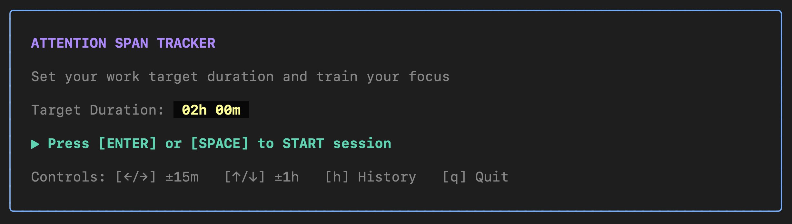

# Attention Span

`attention-span` visualizes and train our concentration through the **"Race of Lines"** metaphor: total elapsed session time races against pure focus time, plotting visual "drops" whenever the attention slips.

- **Session Review & Performance Rating**: Instant post-session metrics breaking down planned vs. actual time, pure focus time, distracted time, focus ratio percentage, and a log of distraction drops.
- **Lifetime History & Persistence**: Automatic local JSON storage for reviewing past sessions and aggregate stats. Sessions are saved automatically to `~/.config/attention-span/history.json`.
- **Fast & Standalone**: Single binary with no external runtime dependencies, cross-compiled for **MacOS ARM64 and Linux AMD64**.

---

## Usage

Launch the interactive TUI with the default 2-hour target:

```bash
attention-span
```



---

## Installation

This project is currently in active development without prebuilt binary releases, so building it locally requires Go as a prerequisite.

### Prerequisites

- Go 1.22+
- `make` (optional)

### Build & Install (macOS & Linux)

```bash
# Clone the repository
git clone https://github.com/quanghong/attention-span.git
cd attention-span

# Install via go install
go install ./cmd/attention-span
```

---
